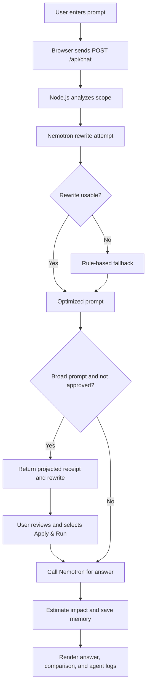

# Minima

**An AI prompt-optimization agent with a transparent estimate of token and energy impact.**

Built independently in 24 hours for the **NVIDIA × ASUS NemoClaw Hackathon at UC Santa Cruz (May 2026)**.

[Hackathon submission on Devpost](https://devpost.com/software/minima-j61cws) · [Source code](https://github.com/Logan-Reynoso/Minima)

> **Project status:** Working hackathon prototype. Energy and carbon figures are **model-based estimates**, not measurements of actual GPU electricity use. A continuously available public demo has not been verified.

## Why I built it

Open-ended prompts can lead to more output than the user needs. Minima explores a different workflow: analyze the request *before generating the final answer*, suggest a narrower version, and show a projected resource comparison that the user can inspect before choosing to continue.

The central question is whether we can make prompt scope and inference tradeoffs more visible to users—not whether we can measure exact hardware energy from text alone.

## What it does

- **Prompt analysis:** Heuristics detect broad, underspecified questions and identify missing constraints such as length, audience, and format.
- **Nemotron-powered rewriting:** An NVIDIA NIM API call attempts to turn the prompt into a shorter, more specific request. A deterministic fallback handles unsuccessful rewrites.
- **Pre-flight approval:** For requests flagged as wasteful, the app returns a projected comparison without generating the final answer. Users can review the proposed rewrite and click **Apply & Run**.
- **AI-generated responses:** After approval—or directly for prompts not flagged as wasteful—the backend calls Nemotron to generate an answer.
- **Impact dashboard:** The UI displays estimated tokens, energy ranges, an original-vs-optimized comparison, an agent timeline, policy decisions, and tool-call logs.
- **Persistent memory:** A JSON file saves aggregate usage information and recent prompts between server restarts. This prototype currently uses a shared memory file; see [Limitations](#limitations-and-next-steps).

**Important:** The pre-flight stage may itself call Nemotron **to create the rewrite**. “No answer-generation call” does **not** mean “no model call.”

## Architecture



The browser communicates with a single Node.js HTTP server. That server handles `/api/chat`, calls the NVIDIA NIM endpoint, serves the static frontend, and persists JSON memory on disk.

## Tech stack

| Layer | Implementation |
| --- | --- |
| AI model | NVIDIA Nemotron (`nvidia/nemotron-3-nano-30b-a3b`) via NVIDIA NIM-compatible API |
| Server | Node.js 22+, built-in `node:http` and filesystem APIs |
| Frontend | Vanilla JavaScript, HTML, CSS |
| State | JSON-file persistence (`data/memory.json`) |
| Deployment | Docker / Docker Compose; originally deployed using NVIDIA Brev |
| Verification available in repo | JavaScript syntax checks (`npm run check`) |

## Run locally

**Requirements:** Node.js **22 or newer** and a valid NVIDIA API key with access to the configured model.

```bash
git clone https://github.com/Logan-Reynoso/Minima.git
cd Minima
cp .env.example .env
```

Open `.env` and replace `NVIDIA_API_KEY=your_key_here` with your own key. **Do not commit your `.env` file.**

Start the app using Node's environment-file support:

```bash
npm run check
node --env-file=.env server.mjs
```

Then visit **http://localhost:3000**.

### Docker option

After creating `.env` as described above:

```bash
docker compose up --build -d
```

Open **http://localhost:4000** (or the port set by `HOST_PORT`). Docker Compose stores the JSON memory in a named volume.

**Note:** `npm run check` verifies JavaScript syntax only. It is **not** a unit/integration test suite, and successful local inference requires a working NVIDIA API key and endpoint.

## Example interaction

1. Type a broad request such as `Explain all of machine learning to me in detail.`
2. Select **Run Agent**.
3. Minima diagnoses the scope and proposes a bounded rewrite.
4. Review the original-versus-optimized **projected** impact and the policy/tool logs.
5. Select **Apply & Run** to request an answer using the rewritten prompt.

The dashboard's energy, carbon, and equivalency values are educational estimates. See [Estimation methodology](docs/ESTIMATION_METHOD.md) for the actual formulas and their limitations.

## Project structure

```text
Minima/
├── server.mjs             # HTTP server, AI calls, analysis, estimates, persistence
├── public/
│   ├── index.html         # Dashboard structure
│   ├── app.js             # Browser interactions and API calls
│   └── styles.css         # UI styling
├── scripts/
│   └── brev-start.sh      # Docker-based deployment helper
├── Dockerfile
├── docker-compose.yml
├── .env.example           # Environment variable template (not a secret)
└── docs/
    └── ESTIMATION_METHOD.md
```

## Engineering decisions

- **Model-assisted rewriting with a fallback:** The optimizer retries unusable model output; if it still fails, a deterministic rewrite keeps the workflow usable.
- **Human approval for flagged prompts:** The app separates a pre-flight estimate from answer generation so users can inspect a rewrite before proceeding.
- **Inspectable decisions:** Policy checks, tool-call logs, and before/after projections are presented in the UI rather than hidden behind a single score.
- **Deployment portability:** A Dockerfile and Compose configuration allow the same codebase to run beyond the original hackathon environment.

## Results and interpretation

During the hackathon, Minima reported **up to 97% projected savings in its estimated-energy comparison** for a selected prompt. This is an *illustrative model output*, **not** a 97% measured reduction in actual electricity or emissions, and the figure has not been reproduced here as an independent benchmark.

In particular, the prototype's estimator uses heuristic token predictions and assumed energy coefficients; the displayed comparison does **not** comprehensively account for every optimizer call, retry, or hardware-specific power profile. See [Estimation methodology](docs/ESTIMATION_METHOD.md).

## Limitations and next steps

This is a hackathon prototype rather than a hardened multi-user SaaS product. Priorities before hosting an unrestricted public demo:

- **Privacy:** Remove or isolate shared recent-prompt history; the current JSON memory and API responses may reveal other visitors' prompts.
- **API protection:** Add request-size limits, authentication or demo quotas, rate limits, and usage/spend caps for the NVIDIA endpoint.
- **Testing:** Add automated tests for scope detection, rewrite fallback, HTTP behavior, and estimation formulas.
- **Evaluation:** Benchmark representative prompts, disclose estimator assumptions, and include optimizer overhead in end-to-end comparisons.
- **Portfolio media:** Add real UI screenshots and a short recorded walkthrough; do not substitute fabricated output images.
- **Deployment:** Provide an HTTPS demo link after verifying reliability, privacy, and API cost protections.

## Author

Built by **Logan Reynoso** during the NVIDIA × ASUS hackathon at UC Santa Cruz.

[GitHub](https://github.com/Logan-Reynoso) · [LinkedIn](https://www.linkedin.com/in/logan-reynoso/) · [Devpost](https://devpost.com/software/minima-j61cws)
